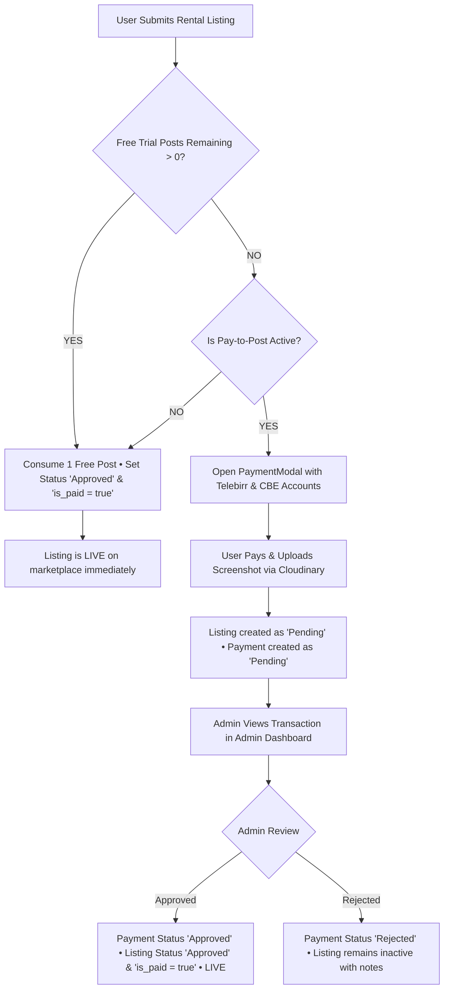

# 🏠 የኔ ኪራይ (Yene Kiray) — Complete Project Workflow & System Specification

> **Platform Overview:** "የኔ ኪራይ" is a modern, high-performance rental marketplace for Ethiopia and the diaspora — connecting property and equipment owners with clients seeking to rent houses, apartments, vehicles, heavy machinery, shops, and event venues.

---

## 👥 1. User Roles & Access Control

| Role | Provisioning | Core Permissions |
| :--- | :--- | :--- |
| **Super Admin** | Created securely via **Terminal/CLI seed only** (`npm run seed:admin`) | Manage official Telebirr & CBE accounts, set posting fee & free trial limits, review & approve/reject payment proofs, toggle pay-to-post, manage categories, moderate users & listings |
| **Client / User** | Self-registration via web platform (`POST /api/auth/register`) | Create profile, receive one-time sign-up free trial posts, publish rental listings, upload payment receipts, real-time live chat with owners/renters, save listings |

---

## 💳 2. Monetization & Payment Business Logic

### A. Admin Account & Pricing Controls
From the **Admin Dashboard -> Payments & Pricing Tabs**, administrators dynamically control:
1. **Official Telebirr Account**: Beneficiary Name & Merchant / Phone Number.
2. **Official CBE Account**: Commercial Bank of Ethiopia Account Holder Name & Bank Account Number.
3. **Posting Fee (ETB)**: Price charged per listing once free trial posts are exhausted (default: 200 ETB).
4. **Free Trial Posts Count**: Number of free posts automatically granted to new users upon account registration.
5. **Pay-to-Post Toggle**: Global master switch enabling or disabling mandatory payment for posts.

---

### B. One-Time Registration-Locked Free Trial Policy
1. **Registration Snapshot**:
   - At the exact moment a user registers, the system reads the active `free_trial_posts_count` setting from the database and records it directly into `users.free_trial_posts_remaining`.
   - **Independence Guarantee**: If the administrator subsequently changes the global free trial limit (e.g., from 3 to 0 or 5), existing registered users keep their recorded balance. Changing the policy only affects *future* sign-ups.
2. **Posting Consumption**:
   - Every time a user publishes a rental listing:
     - If `free_trial_posts_remaining > 0`: Listing is **instantly approved** (`is_paid = true`), and the user's balance is decremented by 1 (`free_trial_posts_remaining - 1`). No payment is requested.
     - If `free_trial_posts_remaining === 0` (or 0): If pay-to-post is enabled, the user is prompted with the **Payment Modal**.
3. **In-Page Visibility**:
   - **Post Rental Page Header**: A compact pill displays the user's remaining free trial posts (e.g. `🎁 3 Free Posts Remaining` in emerald).
   - **Action Bar**: Right next to the submit button, an indicator confirms whether the listing will publish for free or require a fee.
   - **Navbar User Dropdown**: The user's avatar menu displays their current free trial balance.

---

### C. Payment Verification & Listing Activation Pipeline



1. **User Submission**: User copies official Telebirr or CBE account numbers with one-click copy buttons, completes transfer, and uploads the transaction receipt screenshot (stored securely on Cloudinary in `yene_kiray/receipts`).
2. **Admin Verification**: In **Admin Dashboard -> Payments**, admins inspect high-resolution screenshots in a built-in zoom lightbox and review transaction references.
3. **Instant Activation**: Clicking **Approve** immediately updates the payment to `approved`, transitions the listing to `status = 'approved'` and `is_paid = true`, clears system cache, and publishes the item live to searchers.

---

## 🛠️ 3. Technology Stack

- **Frontend**: React 18, Vite, Redux Toolkit, TailwindCSS, Lucide React Icons, Socket.io-client.
- **Backend**: Node.js, Express, Socket.io (WebSocket + Long-polling), Multer, Cloudinary SDK.
- **Database**: Neon Serverless PostgreSQL with pg-pool.
- **Authentication**: JWT (JSON Web Tokens) with 7-day expiration and bcryptjs password hashing.
- **Real-Time Engine**: Socket.io bidirectional private user rooms for live chat and notifications.

---

## 🚀 4. How to Run Locally

### Prerequisites
- Node.js (v18+ recommended)
- Git

### 1. Start the Backend API Server
```bash
cd server
npm install
npm run dev
```
*Runs on `http://localhost:5000` connected to Neon PostgreSQL.*

### 2. Start the Frontend Application
```bash
cd frontend
npm install
npm run dev
```
*Runs on `http://localhost:5173`.*

### 3. Seed Super Admin (First Time Only)
```bash
cd server
npm run seed:admin
```
*Credentials: `admin@gmail.com` / `123456789`*

---

## 📁 5. Directory Structure in Source Code Archive
```text
yene-kiray/
├── frontend/             # Complete React + Vite SPA (src, public, assets)
├── server/               # Node.js + Express REST API (controllers, routes, config, scripts)
├── scripts/              # Helper utilities (asset & logo generation)
├── README.md             # Project overview
├── workflow.md           # Business logic & workflow specification (this document)
└── Yene_Kiray_Project_Workflow.docx # Microsoft Word executive report
```
*(Note: `node_modules` folders are intentionally omitted to keep the archive lightweight and portable. Run `npm install` inside `frontend` and `server` to install dependencies.)*
