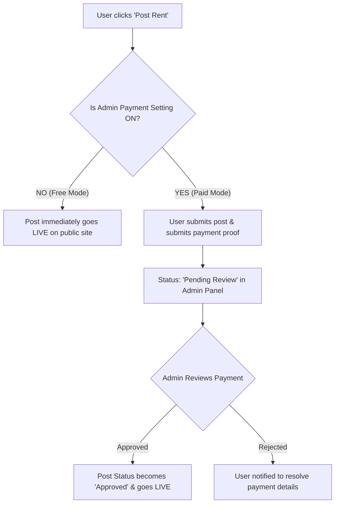

# 🏠 የኔ ኪራይ (Yene Kiray) — Project Workflow & Business Specification

> **Platform Concept:** A modern, multi-category rental marketplace for Ethiopia and beyond — connecting property and vehicle owners with clients looking to rent houses, cars, machinery, and everyday equipment.

---

## 👥 1. User Roles & Access Control

| Role | Creation / Registration | Core Permissions |
| :--- | :--- | :--- |
| **Super Admin** | Created securely via **Terminal/CLI seed only** (No public registration page) | Manage categories, manage users & statuses, set posting fee & pricing toggle, review payments, view financial dashboard |
| **Client / User** | Self-registration via website (Default role: `User`) | Create profile, post rental items, chat with renters/owners, save favorites, manage own listings |

---

## 🔄 2. Core Business Workflows

### A. Client / Renter Flow
1. **Sign Up & Profile:** Client registers an account and sets up their contact profile (name, phone number, location, avatar).
2. **Browse & Search:** Visitors can filter listings by category (House, Car, Machinery, etc.), location, and price.
3. **Save / Bookmark:** Users can save listings to their personal "Saved Rents" list for quick access.
4. **Direct Interaction (Live Chat):**
   - Built-in real-time online messaging (**Socket.io**) directly between the renter and the listing owner.
   - Verified phone & direct contact options for immediate deals.

---

### B. Rental Posting & Payment Approval Flow

1. **Free Posting Mode (When Admin turns Fee OFF):**
   - Users can post rental listings immediately at no cost.
   - Listings go live instantly to drive initial platform adoption.
2. **Paid Posting Mode (When Admin turns Fee ON):**
   - Admin configures the posting fee (fixed price or subscription tier).
   - User fills listing details and clicks "Submit / Paid".
   - The listing enters **"Pending Approval"** state.
   - Admin verifies the payment from the Admin dashboard and updates status to **"Approved"**.
   - The listing instantly becomes visible to all searchers and opens chat connections.

---

### C. Admin Operations & Financial Dashboard
1. **Category Management:**
   - Add, edit, or disable rental categories (e.g., Apartments, Villas, SUV Cars, Heavy Trucks, Event Venues, Construction Tools).
2. **User Management:**
   - View all registered users.
   - Toggle user account status (**Active** / **Inactive / Suspended**).
   - Edit user profile details if needed for moderation.
3. **Monetization Settings:**
   - Single-click toggle to switch between **Free Posting** and **Paid Posting**.
   - Set listing fee amount.
4. **Financial Dashboard:**
   - Total platform earnings overview.
   - Detailed transaction log (User, Date, Amount, Listing ID, Status).
   - Payment verification queue for one-click approval.

---

## 🎯 3. Executive Summary Checklist (For Management Sign-off)

- [x] **Brand & Identity:** "የኔ ኪራይ" — house, car, and multi-category rental marketplace.
- [x] **Security:** Admin accounts created strictly via terminal seed; zero public backdoor.
- [x] **Monetization Flexibility:** Instantly switch between free growth mode and paid listing revenue.
- [x] **Transaction Transparency:** Full financial dashboard and payment review pipeline.
- [x] **Engagement Engine:** Instant real-time chat between interested renters and owners.
- [x] **User Retention:** Saved rentals wishlist and personal listing manager.
